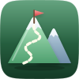
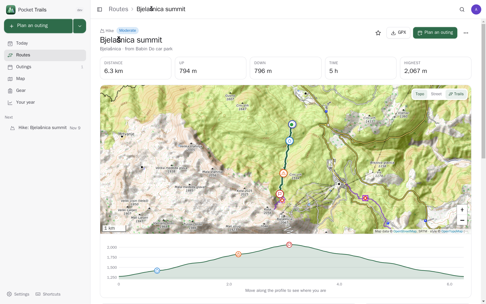
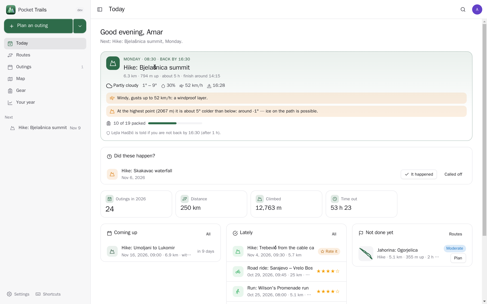
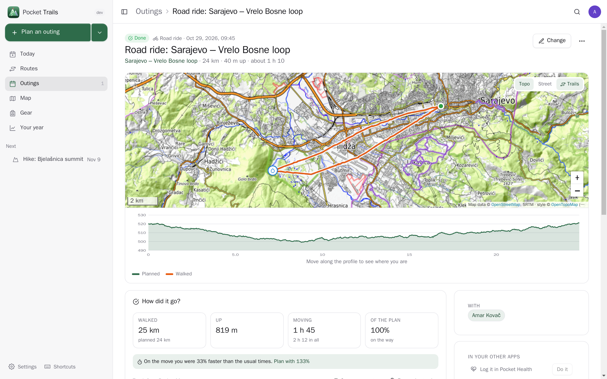
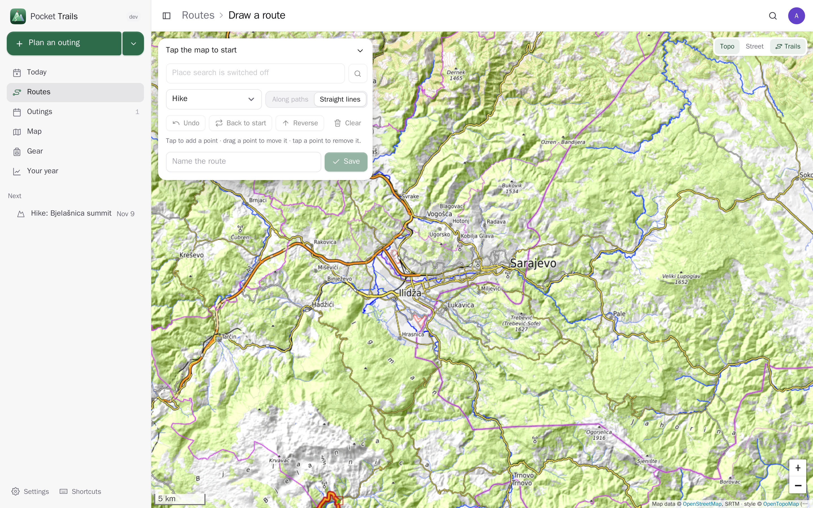
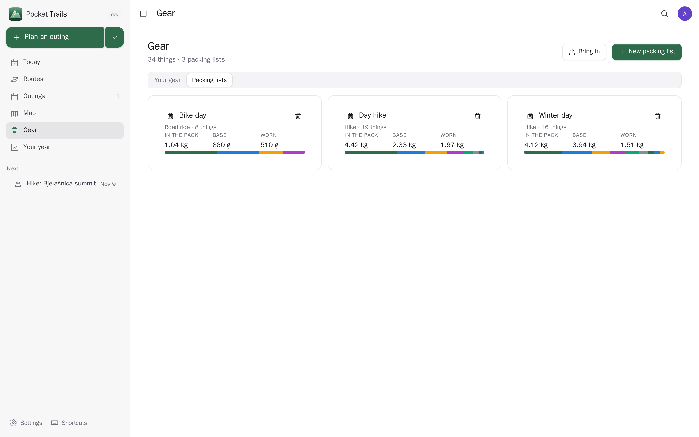
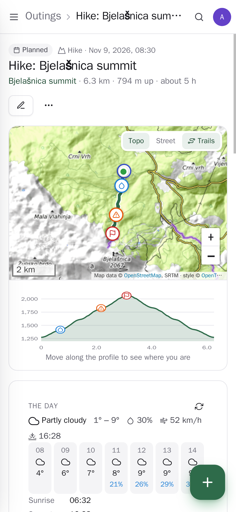
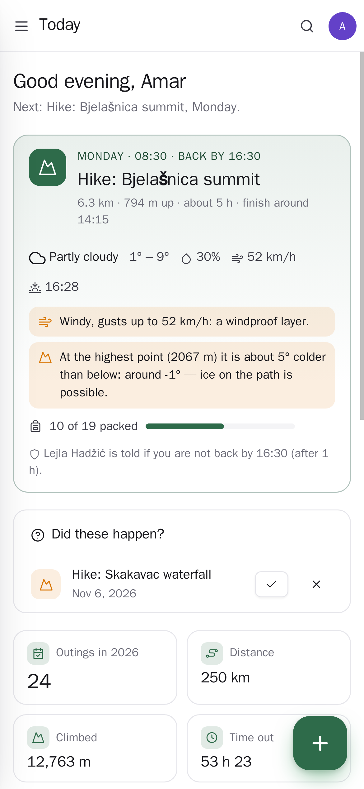

<p align="center"></p>
<h1 align="center">Pocket Trails</h1>
<p align="center">Plan hikes, walks, runs and bike rides: routes on a map — brought in from a GPX (Komoot, AllTrails, Strava, a watch) or drawn along the paths — with the climb, the time they take and the water, huts and summits along the way; what to pack and what it weighs; the weather and sunset on the day with what to know ("you would finish after sunset", "about 5° colder at the top"); a time to be back by that emails someone if you are not; and afterwards how it went, the walked track against the plan. Offline on the trail with the GPX in any map app.<br>One Go binary, one SQLite file, one volume. Part of the Pocket apps; works on its own too.</p>
<p align="center">
  <a href="https://github.com/abjelosevic88/pocket-homelab-trails/actions"></a>
  <a href="https://github.com/abjelosevic88/pocket-homelab-trails/pkgs/container/pocket-homelab-trails"></a>
  <a href="LICENSE"></a>
</p>

---

<p align="center"></p>

<table>
  <tr>
    <td width="50%"></td>
    <td width="50%"></td>
  </tr>
  <tr>
    <td align="center"><sub>Today: the next outing with its weather, what to know and how much is packed; outings to mark; the year.</sub></td>
    <td align="center"><sub>After an outing: the walked track (orange) over the plan, how much of it you did, time on the move.</sub></td>
  </tr>
  <tr>
    <td width="50%"></td>
    <td width="50%"></td>
  </tr>
  <tr>
    <td align="center"><sub>Drawing a route: tap the map, the way follows the paths, with the climb and the time as you go.</sub></td>
    <td align="center"><sub>Packing lists with what they weigh: base, worn, food and water.</sub></td>
  </tr>
  <tr>
    <td width="50%"></td>
    <td width="50%"></td>
  </tr>
  <tr>
    <td align="center"><sub>An outing on the phone.</sub></td>
    <td align="center"><sub>Today on the phone: “Setting off” and “I'm back” are one tap.</sub></td>
  </tr>
</table>

## What it does

- **Routes**: bring in GPX, KML (Google My Maps), TCX or GeoJSON — every track a route, the marked spots with it, the same file twice finds the same route; or **draw** one by tapping the map, straight or along paths (BRouter), with heights (Open-Meteo); or make one from a day Pocket Movement recorded. Distance, climb up and down, highest point, a loop or there and back.
- **How long and how hard**: the hiking clubs' time rule (DIN 33466: 4 km an hour, 300 m up, 500 m down), riding speeds for road, gravel and mountain bikes, at *your* speed (Trails tells you what you really did after each outing); easy to very hard from length and climb.
- **The map**: OpenTopoMap with contour lines, the marked hiking or cycling routes over it (Waymarked Trails), or the street map; dark mode dims it. A height profile you move along, with a dot following on the map.
- **Spots along the way**: water, huts, food, shelter, summits, viewpoints, the car park, a bus stop, tricky bits — each with how far along it is.
- **Outings**: a route on a day, who comes, notes, the trip it is part of. **The day**: the forecast at the start hour by hour, sunrise and sunset worked out offline, and what to know — finishing after dark, storms, rain, wind, heat, frost and how much colder it is at the top, no water on a long way.
- **Be back by**: a time, and someone to tell. At the time you get “Are you back?”; if you have not tapped “I'm back” a while later, they get an email with your plan (the start on a map, who is with you). When you are back, they are told that too. You can also send your plan before you go.
- **Gear and packing lists** with weights (base, worn, food and water), a list per outing to tick off, gear still to buy; bring in a LighterPack CSV.
- **How it went**: rating, trail conditions for next time, the story; the walked track from Pocket Movement or a GPX, compared with the plan (how much of it you did, how far off, time on the move against stopped). Save what you walked as a new route.
- **Your year**: distance, climb, time out, summits, month by month and by activity.
- **Offline on the trail**: every route downloads as GPX for OsmAnd, Organic Maps, Komoot or a watch, and prints as a route sheet.
- **Pocket AI** (optional, only when you press it): what else to pack (from the route, the weather and your own gear), a draft of how it went, a route described.
- **Everyone their own** on one box; admins see no one else's routes. **Messages** through Apprise, ntfy or a webhook: the evening before and the morning of an outing.

## Run it

```sh
docker run -d --name pocket-trails -p 8080:8080 -v ./data:/data \
  -e BASE_URL=https://trails.example.com -e SECURE_COOKIES=true \
  ghcr.io/abjelosevic88/pocket-homelab-trails:latest
```

or `docker compose up -d` with [docker-compose.yml](docker-compose.yml). Open it, create the first account and bring in a route. All options: [docs/configuration.md](docs/configuration.md). API: [docs/api.md](docs/api.md). Backups: [docs/backup.md](docs/backup.md).

## With Pocket Core

Set `CORE_URL` and `CORE_REGISTRATION_KEY` and Trails joins the box: people sign in with Pocket Core, Pocket AI helps, and through app links your trails reach your own Pocket apps with nothing to paste:

| App | In Trails | Without it | Scopes |
|---|---|---|---|
| Pocket Movement | the walked track compared with the plan; a route from a day it recorded | upload the walked GPX | `movement:read`, `movement:points` |
| Pocket Weather | the forecast at the start of the route, hour by hour | Open-Meteo directly (when online lookups are on) | `weather:read` |
| Pocket Calendar | outings from setting off to the back-by time, kept in step | — | `calendar:write` |
| Pocket Contacts | pick who comes along and who to tell | type their names and email | `contacts:read` |
| Pocket Health | a finished outing as a workout | — | `health:write` |
| Pocket Mail | your plan before you go, and “not back yet”, from your own mailbox | you get the reminder yourself | `mail:send` |
| Pocket Inventory | your outdoor things into your gear list | add gear by hand | `items:read` |
| Pocket Places | your saved huts and restaurants near a route; a spot saved as a place | — | `places:read`, `places:write` |
| Pocket Travel | an outing filed under its trip | — | `trips:read` |
| Pocket Notes | how it went, as a note | — | `notes:write` |
| Pocket Tasks | gear still to buy, due the day before | — | `tasks:write` |

**Nothing depends on another app.** Each app's state is checked per person — connected, switched off here, switched off in Pocket Core, not on this box, too old — and what needs it is shown greyed out with one line saying why and what to do, never hidden.

Other apps use your trails through `trails:read` and `trails:write`: Pocket Day writes your outings into your journal, Pocket Weather adds them to its plans, Pocket Travel shows them on a trip, Pocket Search finds routes and outings, Pocket AI says what is next and plans an outing when you ask — another app can never arm “tell someone”. Events on the bus — `trails.outing_planned`, `trails.outing_today`, `trails.outing_started`, `trails.outing_done`, `trails.outing_cancelled`, `trails.overdue`, `trails.route_saved` — start flows in Pocket Flows. Without Core every connection can be made directly with a URL and a token; the Core-only choices stay visible, greyed out.

The free services (OpenStreetMap's Nominatim, Open-Meteo, BRouter, the map tiles) need no account; looking things up online can be switched off per person.

## Develop

```sh
make dev     # API on :8080 with demo data + Vite on :5173
make test    # go vet, go test, tsc
make         # web + binary
```

`node scripts/screenshots.mjs` takes the screenshots above from a demo instance and fails on any browser error. MIT licensed.
